# Super Clipping on the Las Vegas Strip Straight: 2026 vs 2025 Qualifying

## Context

For this analysis, we will be comparing the effects of super clipping on the cars down the Las Vegas Strip straight. According to [RACER](https://racer.com/racerpedia/series-guides/formula-1/what-is-clipping-and-super-clipping), “Super clipping is a Formula 1 energy-management technique introduced under the 2026 power unit regulations, where the MGU-K switches into harvest mode while the driver stays at full throttle—typically at the end of a straight or through a fast corner—diverting up to 250 kW of power from the rear wheels to recharge the battery.” Before we dive into the analysis, I want to explain the differences between the regulations and why we have “Super Clipping”.

The 2025 cars belonged to the “Ground Effect Era”. This era of Formula 1 cars exploited ground effect, a term that comes from aviation. When a wing flies close to the ground, the air beneath it is squeezed against the ground, which raises the pressure under the wing and pushes the aircraft upwards. Formula 1 cars use the same idea upside down: the floor is shaped like an inverted wing, with tunnels underneath that speed up the air flowing under the car. The combination of fast-moving air below and slower air above the car creates a suction force that pulls the car onto the track ([Illumin, USC](https://illumin.usc.edu/the-ground-effect-an-analysis-of-aerodynamics-and-overtaking-of-formula-1-cars/)). The overall explanation for this effect comes from Bernoulli’s Principle, stating that “an increase in the speed of a fluid occurs simultaneously with a decrease in pressure or a decrease in the fluid's potential energy.”

The 2026 regulations greatly reduced this effect. Instead of favoring aerodynamics for these regulations, the FIA focused on the engine and hybrid power. The V6 turbo hybrid remained the same, however, the MGU-H (Motor Generator Unit – Heat) was dropped, the dimensions of the cars became smaller, the electric motor (MGU-K) became almost three times more powerful, and most importantly, the ground effect floors were replaced with much flatter floors. The power unit (PU) became almost a 50/50 split between a roughly 400 kW ICE (Internal Combustion Engine) and a 350 kW electric motor (the MGU-K), which is fed by the battery ([FIA](https://www.fia.com/F126)). The cars also gained active aerodynamics: on designated straights, drivers switch the front and rear wings into a low-drag Straight Mode, which replaced DRS ([Formula 1](https://www.formula1.com/en/latest/article/from-smaller-cars-to-a-bigger-budget-cap-12-rule-changes-you-need-to-know-about-in.56uUTFhB0z5j3iZfhC0rGP)). The 2025 cars could open DRS on this straight in qualifying, so both years ran a low-drag setup, but the two systems are not the same, and that matters for a straight-line comparison.

In this analysis, we will look at multiple graphs of telemetry such as speed, throttle, longitudinal acceleration, RPM, and gear over the course of the roughly 1.9 km Las Vegas Strip straight.

## Data and Method

All data comes from the 2025 and 2026 Las Vegas Grand Prix qualifying sessions, loaded with [FastF1](https://github.com/theOehrly/Fast-F1). For each year I took the fastest Q3 lap of each of the top ten qualifiers and kept the telemetry between 3,200 m and 5,300 m, which covers the run down the Strip straight and the braking zone at the end of it. FastF1 does not provide longitudinal acceleration directly, so I calculated it from the change in speed between telemetry samples (Δv / Δt, converted to g). This raw calculation is noisy, which is why I focus on the LOWESS trend line rather than individual points.

**2026 top ten:** ANT, VER, RUS, NOR, HAD, LIN, PIA, LAW, GAS, COL

**2025 top ten:** NOR, VER, SAI, RUS, PIA, LAW, ALO, HAD, LEC, GAS

## Longitudinal Acceleration

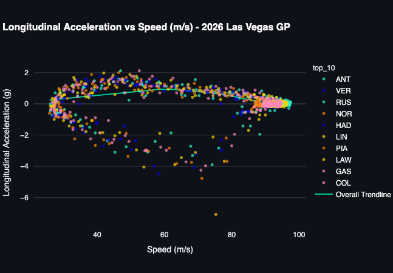 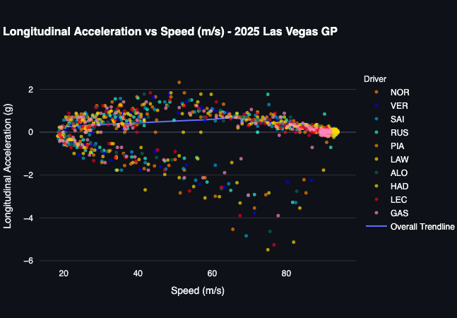

Longitudinal acceleration, measured in g forces, is the force the drivers feel while accelerating. Negative values represent braking, positive values represent acceleration. The individual points are noisy, but the shapes of these charts expose how the differences between the regulations interact with the cars. We will be focusing on our LOWESS trend line. As you would expect, the relative shape of the trend line is similar; it rises as the cars move down the straight, and falls off when they enter the braking zone. Zooming in to the peaks gives us the information we are looking for. In 2026 the trend line peaks at 0.94 g at about 212 km/h (58.9 m/s). In 2025, g forces maxed out lower at 0.67 g at about 236 km/h (65.6 m/s). This is what the new set of regulations were trying to achieve; not necessarily increasing the speed in which the cars travel, but how fast they are able to accelerate. The much more powerful MGU-K delivers a lot of extra power immediately, which is why the 2026 cars accelerate harder at lower speeds. On its own, the earlier peak does not prove the battery is running out, because acceleration always falls as speed rises and aerodynamic drag grows. The evidence for that comes from the speed and throttle traces below.

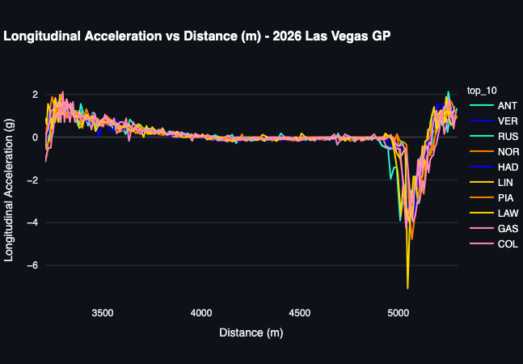 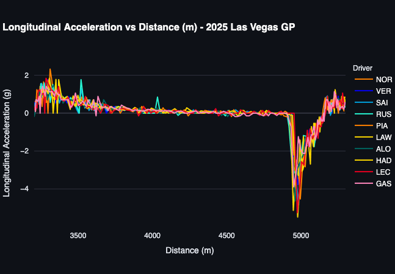

Viewing these two visualizations, we can see where the acceleration stops. The 2026 cars are reaching 0 g much earlier than in 2025, meaning they stop gaining speed much earlier. Reaching 0 g on its own means a car has stopped accelerating, not that it is slowing down. What points to super clipping is that the 2026 traces sit slightly below 0 g through the middle of the straight, before the braking zone, while the drivers are still at full throttle. The deceleration of the 2026 cars is also much more inconsistent than in 2025. This could be because of a multitude of reasons such as different deployment strategies, different power units, and the new active aero.

## Speed and Throttle vs Distance

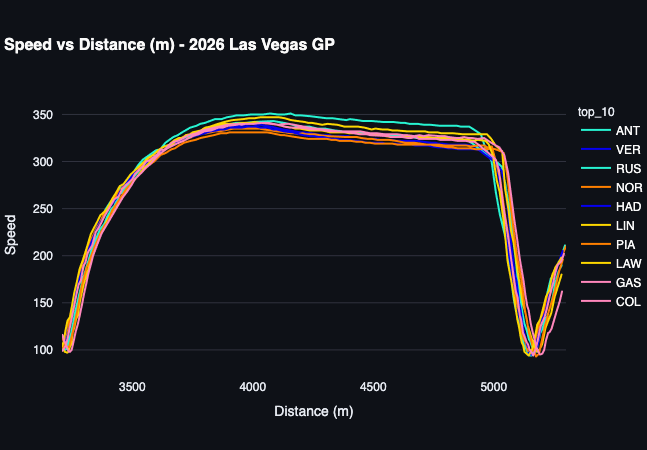 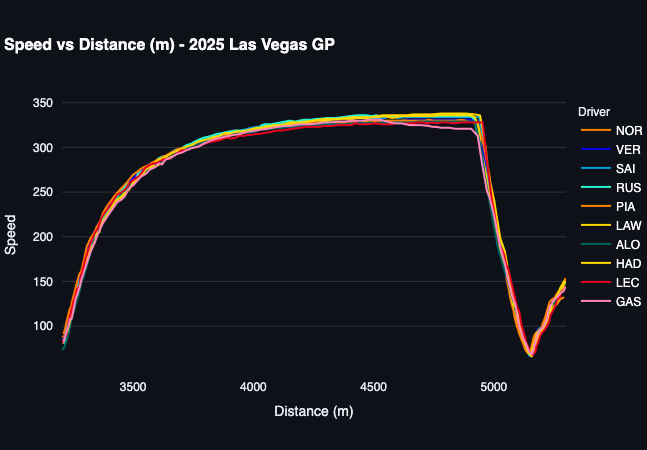

Speed, compared with throttle, is the clearest indicator of super clipping. The whole idea is that the driver remains on the throttle, but the MGU-K stops deploying and switches to harvesting, so speed drops off. Looking at the 2026 visuals, we can see exactly that; speed starts to drop off at around 4000 - 4100 meters, while all the drivers are still 100% on the throttle. On the other hand, in 2025 the cars’ speed continues to increase all the way up to the braking zone, with similar throttle behaviour. The 2026 cars actually reach a higher peak, around 335–350 km/h at 4,000–4,100 m, then lose roughly 15–25 km/h before the braking zone, while the 2025 cars keep building to about 325–338 km/h right at the end of the straight. Part of this may also be by design: early summaries of the regulations said MGU-K deployment tapers off once a car reaches about 340 km/h ([Silverstone](https://silverstone.co.uk/news/f1-2026-rules-and-regulations-talking-points)), which is right where the 2026 traces peak.

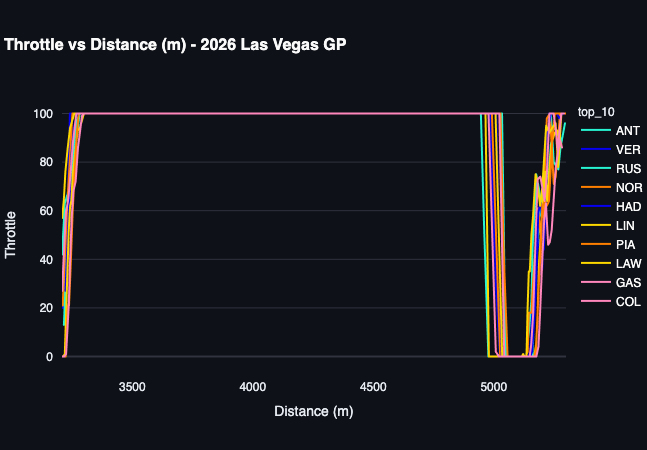 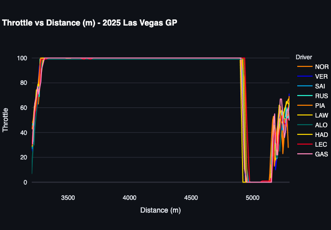

An interesting note about throttle: this year, the drivers actually remain on the throttle longer than they did in 2025. This is specific to this section of Las Vegas, as I have not put information together for every straight on the calendar. Comparing the top ten qualifiers each year, the 2026 driver who lifted earliest stayed on the throttle 20 meters longer than the 2025 driver who lifted earliest. One likely reason is simple: the 2026 cars arrive at the braking zone slower, so they need less distance to brake and can stay flat out a little longer.

## RPM and Gear

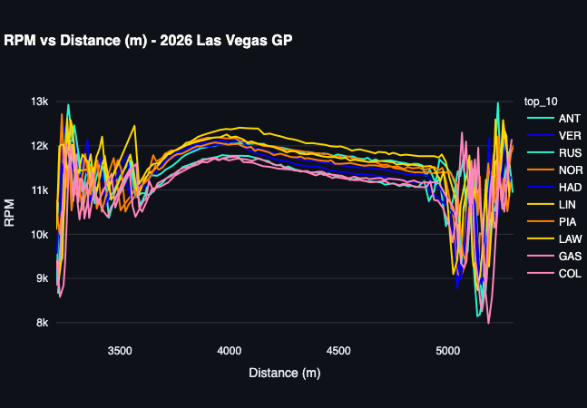 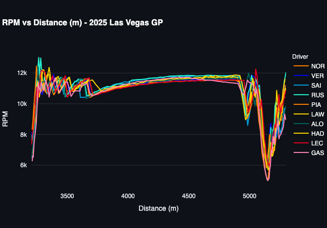

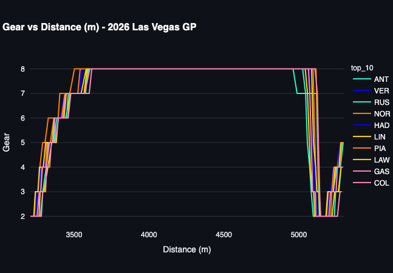 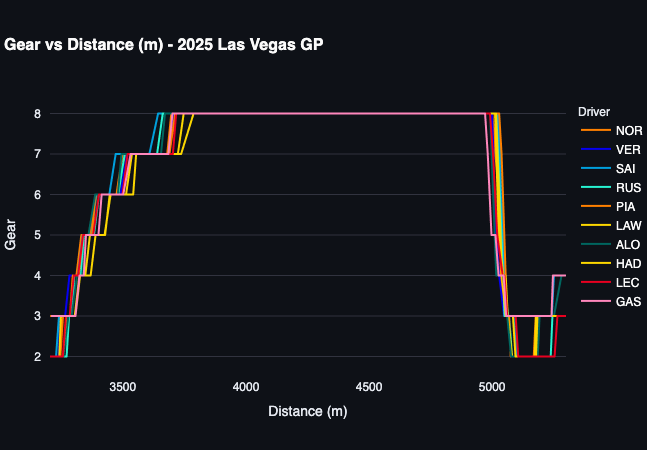

These visuals do not confirm or deny any assumptions about super clipping, but I still found it interesting to cover the shapes they present. What is true for these is also true for other visuals discussed. In 2026, telemetry data for this section of the Las Vegas track shows extreme variability compared to 2025. The RPMs between the cars range much farther from highest to lowest, giving us less uniformity. As for gears, some drivers shift down earlier, or rip through the gears quicker than in 2025. I believe this is for two reasons.

**Number 1: Battery Deployment.** This has always been a factor since the beginning of the turbo hybrid era in 2014, but now, it means much more. About half of the power comes from the electrical system, so deployment weighs much more than in recent years. Drivers all have their own ways of deploying across a lap, and since this means so much more for driving, it can create this variability and inconsistency in telemetry data. This also leads into my second reason.

**Number 2: Battery Harvesting.** Since the drivers have different battery deployment strategies, they also have different battery harvesting strategies. Having to get off the throttle, turn off boost, and shift gears at different rates/times can create the variability we are looking at.

There is also a factor I can't separate from these two with this data. In 2025, teams were in the fourth year of the same rules and the cars had largely converged. 2026 is the first year of new cars and new power units, and the 2026 top ten is split between Mercedes and Red Bull-Ford power units, which may manage energy very differently. Some of the variability is likely car-to-car rather than driver strategy. FastF1 has no ERS data, so I can't measure deployment or harvesting directly, and both reasons above should be read as hypotheses.

## Takeaways

Super clipping is affecting the cars. There are more variables across a lap because of this effect and because of the much larger electrical deployment. We are seeing more overtaking (the 2026 Las Vegas Grand Prix had 352 overtakes, according to [Formula 1](https://www.formula1.com/en/latest/article/the-ingredients-that-created-a-grand-prix-with-352-overtakes.3IEhw6LQ9NQG9sF0orRKqV)), but completely different car behavior. Acceleration comes quickly, but drops off dramatically down the straight. Drivers are being forced to think about more actions across a lap, which is giving us more insight into how they interact with their car. Formula 1’s impact reaches governments, people, and most importantly, the future of commercial vehicles. This regulation change might have been made in an effort to increase the quality of the sport and for vehicle industries as a whole, but after the FIA announced agreement on a 2030 framework that proposes a return to V8 engines ([Formula 1](https://www.formula1.com/en/latest/article/fia-confirms-unanimous-agreement-on-framework-for-2030-power-units.AZ7EFvWPyGPH0xG1JS8Ud)), it looks like the sport itself has doubts about this direction. One straight in one qualifying session can't settle that, but in my opinion these regulations may go down as one of the biggest missteps in Formula 1’s recent history.
