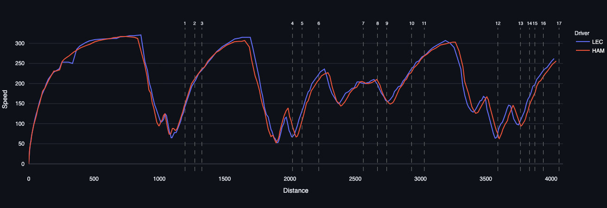
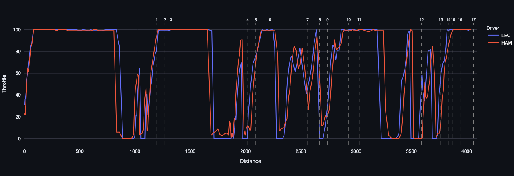
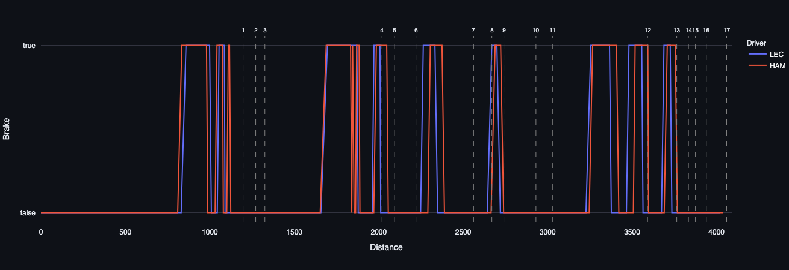
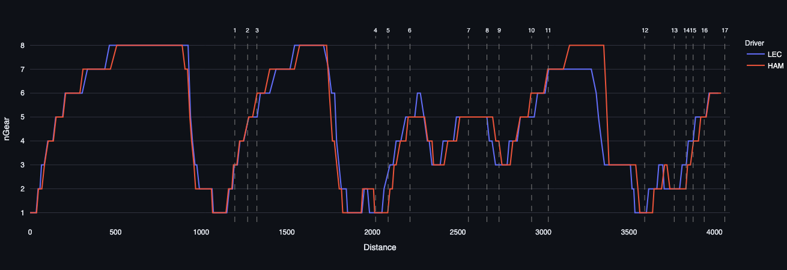

# Ferrari First Lap Battle: 2026 Mexico City Grand Prix

## Context

Lewis Hamilton (HAM) started on pole with Charles Leclerc (LEC) third and Max Verstappen (VER) fifth on mediums. The battle happened on lap 1, mainly through Turns 1–6, and the stewards only noted it on lap 3.

Before the race the stewards issued [Document 54](2026%20Mexico%20City%20Grand%20Prix%20-%20Communication%20from%20the%20Stewards.pdf), explaining how they would apply the driving standards on lap 1 and the first lap after any restart. In Turns 1–3 and 4–6, every car counts as both attacking and defending. A car that leaves the track there and keeps its position may be judged to have gained a lasting advantage. It avoids that by giving the place back by Turn 4 (if it left at T1–3) or Turn 12 (if it left at T4–6). Ferrari gave no team orders [add a source], so the two drivers were free to race.

LEC left the track at Turn 4, so he had until Turn 12 to give the place back to HAM. He was still ahead at T12, and the stewards gave him a 5-second time penalty for leaving the track and gaining an advantage. By the end of lap 1 the order was LEC, VER, HAM, so HAM had gone from pole to third.

Overtaking was also hard that day. Mexico City is about 2,240 m above sea level, and the air is roughly a fifth less dense than at sea level. Thinner air weakens the tow, which makes passing harder. That raises the cost of losing a position. Every chart below is lap 1.

## Speed

LEC carries more speed than HAM into the first two heavy braking zones, at T1 and T4. His minimum speeds are lower, roughly 65 vs 72 km/h at the first trough. He is trading exit speed for entry speed.

LEC and HAM are level through T4 and T5, and LEC is clearly ahead by T6. That is the advantage the stewards ruled came from leaving the track at T4. VER was only about 1.3 s behind at T4 and level with HAM by T6, so the fight slowed HAM and let VER catch up. HAM’s slightly lower speeds after T6 are consistent with defending against VER and running off the ideal line.

Late in the lap the pattern flips. HAM stays flat out about 60 m longer into T12. This fits a driver who has lost two places and is chasing, though a tow could also explain it.

## Throttle

The throttle trace backs up the speed chart. LEC stays on the throttle longer into T1 and T4, but on the exits he is fully off while HAM still has some throttle through the corner and onto the exit. The flip near the end of the lap shows up here too, with HAM staying on the throttle longer into T12.

## Brake

HAM brakes earlier in the first part of the lap and later in the second half. A clean run into T1 would show one smooth brake application. Here both cars stab the brakes on and off around T1 and T4, which hurts their lines and momentum. VER used this. He was already P3 and right behind the two Ferraris, and he took second place off HAM around T6–T7. Once the fight ended, both drivers’ braking settled into a rhythm.

## nGear

There are two clear differences. After T6, LEC goes up to 6th while HAM stays in 5th. On the T11–T12 straight, HAM reaches 8th while LEC stays in 7th, even though LEC’s peak speed there is slightly higher (about 307 vs 303 km/h).

A natural explanation is energy management, such as different harvesting or deployment earlier in the lap. FastF1 has no ERS data, so I can’t show that and would call it a hypothesis. Small differences in rhythm can still cost time over a lap.

## Putting it together

Each chart supports the others. LEC out-braked HAM into the first two zones, HAM kept his speed through the middle of the corners, and the lap ends with HAM chasing. The traces alone can’t say who deserved to win, because both drivers behaved similarly on the pedals. The stewards’ ruling can: LEC left the track at T4 and gained an advantage, and he knew the rules were strict.

The fight cost Ferrari track position. HAM dropped from pole to third behind VER, and with thin air and tough overtaking he could not get it back. VER only inherited the lead on lap 44, after a safety car and a red flag. I’m not claiming lap 1 handed him the win. I’m claiming it cost Ferrari the position they started with. They led the first 27 laps but finished P2 (HAM) and P4 (LEC).

LEC could have played it smarter. He had been warned about those corners and still took the risk against his own teammate. Ferrari also needs a clear plan for how its drivers race each other, especially on lap 1, when no team orders were given.
