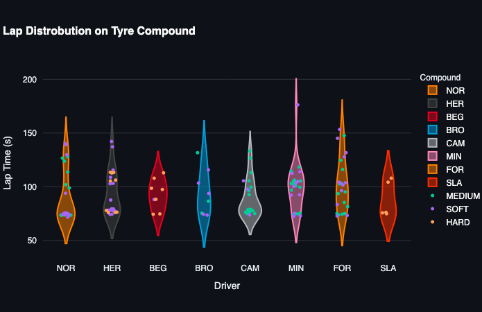
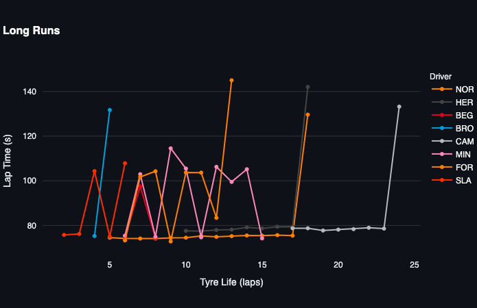

# 2026 Brazil Grand Prix: FP1 Rookie Analysis

## Context

A Formula 1 race weekend consists of multiple sessions: three practice sessions (FP1, FP2, and FP3), a qualifying session, and the race. During the year, each team must put a rookie in the car for an FP1 session at least four times. These rookies are mainly in the car to provide feedback about the car and to help develop its settings based on the conditions of the track. The drivers included are Freddie Slater (SLA), Dino Beganovic (BEG), Colton Herta (HER), Rafael Camara (CAM), Luke Browning (BRO), Leonardo Fornaroli (FOR), Gabriele Mini (MIN), and Lando Norris (NOR). This analysis compares the rookies to Lando Norris, the top performer. One thing to note is that this was CAM’s first F1 session as a full-time driver, which still makes him a rookie, but he will be looked at through a different lens than the others. An exception should also be made for SLA, whose car broke down at the beginning of practice, so he could not record many laps.

## Lap Distribution

This graph shows the distribution of the laps done across the session, as well as which compound each lap was done on. The first thing I want to touch on is the shape of the distribution. Using NOR as a baseline, we can see who compares in terms of consistency and alignment with a practice program. NOR has a group of fast laps at the bottom, and the prep laps appear at a range of slower lap times above the grouped laps. This is reflected in two of the rookies, CAM and HER.

CAM, while still a rookie, has just been signed for the remainder of this season and for next season. I believe this is what makes his distribution close to NOR’s. He has already proven himself as a Formula 1-caliber driver. The distribution reflects his ability to consistently put in fast laps and stick to a program.

HER was the other driver with a similar distribution. His was not as consistent: he has two groups of laps, one a faster group of hot laps and the other a group of cooldown or slower laps. Herta currently competes in F1 and has experience in IndyCar, which puts his skill level above that of the other rookies.

The other drivers’ distributions are all over the place: some have varied groups of slow and fast laps, while drivers like BEG recorded laps all over the timing screens.

## Long Runs

What I stated earlier about some drivers’ abilities being closer to those of full-time drivers is reflected in this graph as well. NOR’s long run consists of consistent lap times that end with a slower lap, and HER and CAM reflect this shape.

The other drivers’ long runs are much more random. Going from one fast lap to one slow lap, we may not be looking at actual long runs, but at a different program than the one NOR, HER, and CAM are running.

## Takeaways

Overall, we can see how the rookies perform differently compared to NOR, our top driver. They are much more inconsistent in their lap times and are slower. The visualizations can give insight into who may be ready to enter the sport, or who has already entered it. However, these insights must be taken with a grain of salt, because different drivers run different programs during practice sessions. This is most often seen when rookies enter a practice session, as teams will often assess how a driver interacts with the team during a session.
